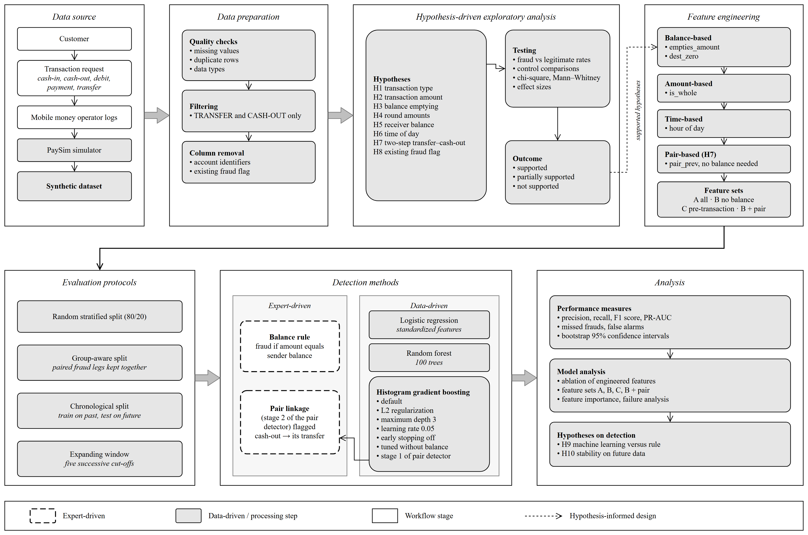
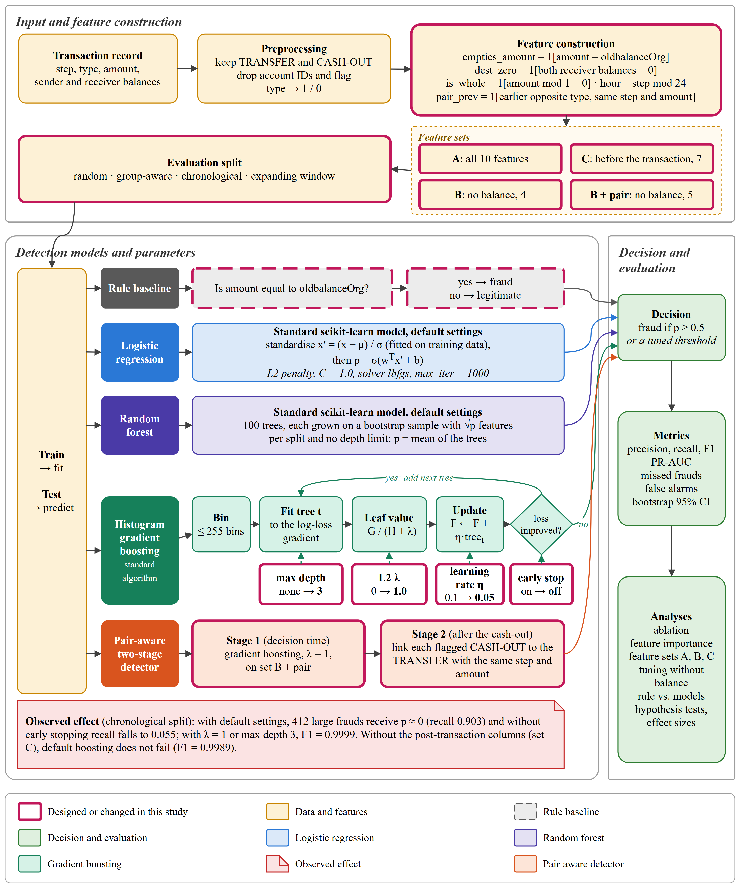

# Hypothesis-Driven Feature Engineering and Machine Learning for Fraud Detection in Mobile Financial Services

**An empirical study on the PaySim dataset**

Md Abdul Quym Shanto, Saiful Islam
Department of Computer Science and Engineering, Daffodil International University, Dhaka, Bangladesh

> Paper under preparation. This repository contains the code, notebook, figures and results behind it.

---

## Overview

PaySim is a widely used synthetic dataset for mobile money fraud detection, and many studies report near-perfect results on it.
This project asks *why*. Instead of starting from a model, we:

1. formulate **ten hypotheses** about how fraudulent transactions differ from legitimate ones,
2. test them on all **6,362,620 transactions** against legitimate-transaction controls,
3. turn the supported hypotheses into features,
4. evaluate a **one-line rule**, **logistic regression**, **random forest** and **histogram gradient boosting** under
   random, group-aware, chronological and expanding-window protocols, and
5. repeat the experiments **without the balance attributes**, which the dataset documentation advises against using, and
6. build a **pair-aware two-stage detector** from the two-step fraud pattern (H7) that needs no balance attribute at all.



## Key findings

- Fraud occurs only in **TRANSFER** and **CASH_OUT** transactions.
- **97.8%** of frauds move the sender's entire balance (`amount == oldbalanceOrg`); no legitimate transaction does.
- Fraud is a **two-step TRANSFER → CASH_OUT** pattern: 99.5% of fraudulent transfers have a fraudulent cash-out with the
  same time step and amount (0.01% for legitimate transactions). The legs cannot be linked by account ID.
- A **one-line rule** (`amount == oldbalanceOrg → fraud`) reaches **F1 ≈ 0.99** with precision 1.0;
  machine learning adds only about **two percentage points of recall**.
- With all features, the best models reach **F1 0.998–0.9999**, stable across five chronological folds.
- **Without the balance attributes, the best F1 falls to 0.42 (random split) and 0.37 (chronological split).**
  Near-perfect PaySim results depend almost entirely on simulator-specific balance information.
- Using only information available **before** the transaction (no `newbalance…` columns) still gives **F1 0.995–0.9999**,
  so the results are not driven by post-transaction leakage.
- A **pair feature** (an earlier TRANSFER with the same step and amount) marks 99.0% of fraudulent cash-outs
  (0.002% of legitimate ones). A **two-stage detector** (flag the cash-out, then link back to its transfer) reaches
  **F1 0.98 without any balance attribute**: PaySim fraud can be found through **two separate simulator shortcuts**.
- Tuning gradient boosting without balance attributes helps only a little (at most +0.15 F1); one good feature helps more.
- Effect sizes (Cramér's V, rank-biserial r) and bootstrap 95% confidence intervals are reported for all hypotheses and
  main models.

| Split | Model | F1 with balance | F1 without balance | PR-AUC without balance |
|---|---|---|---|---|
| Random | Logistic regression | 0.9976 | 0.0000 | 0.029 |
| Random | Gradient boosting (L2 = 1) | 0.9982 | 0.4185 | 0.391 |
| Random | Random forest | 0.9982 | 0.2965 | 0.287 |
| Chronological | Logistic regression | 0.9993 | 0.0000 | 0.084 |
| Chronological | Gradient boosting (L2 = 1) | 0.9999 | 0.2538 | 0.255 |
| Chronological | Random forest | 0.9999 | 0.3730 | 0.315 |

| Without balance attributes (gradient boosting, L2 = 1) | Chronological F1 | Group-aware F1 |
|---|---|---|
| Type, amount, is_whole, hour | 0.2538 | – |
| + pair feature (decision time) | 0.7065 | 0.7046 |
| + pair feature, two-stage detector | **0.9832** | **0.9809** |

### Hypotheses

| # | Hypothesis | Outcome |
|---|---|---|
| H1 | Fraud occurs only in some transaction types | Supported |
| H2 | Fraudulent amounts are larger | Supported |
| H3 | Fraud empties the sender account | Supported |
| H4 | Fraud uses round amounts | Weak |
| H5 | Receiver balance does not change in fraud | Supported (TRANSFER) |
| H6 | Fraud is more likely at night | Partial |
| H7 | Fraud is a two-step TRANSFER → CASH_OUT pattern | Supported (via step + amount) |
| H8 | The existing fraud flag detects fraud | Not supported |
| H9 | Machine learning clearly beats a simple rule | Partial |
| H10 | Results hold on future data | Supported |

## Detection framework



## Repository structure

```
.
├── data/
│   └── README.md                     how to download PaySim (CSV not included)
├── notebooks/
│   └── research.ipynb                full analysis: EDA, hypotheses, models, figures
├── scripts/
│   ├── two_step_fraud_check.py       H7 check and group-aware split
│   └── balance_comparison.py         results with vs. without balance attributes
├── results/
│   ├── expanding_window_results.csv  5-fold chronological evaluation
│   ├── balance_comparison_results.json
│   └── cache/                        saved model runs, created by the notebook (not in git)
├── figures/                          paper figures (PNG/PDF) and draw.io sources
├── literature/
│   └── reading_list.md               annotated reading list (44 papers)
├── requirements.txt
├── LICENSE
└── README.md
```

## Getting started

```bash
git clone https://github.com/aqshanto/Paysim-Fraud-Detection.git
cd Paysim-Fraud-Detection
python -m venv .venv
.venv\Scripts\activate          # Windows  (Linux/macOS: source .venv/bin/activate)
pip install -r requirements.txt
```

Download the dataset as described in [`data/README.md`](data/README.md) and place it at `data/paysim_raw.csv`.

### Reproduce the results

| What | How |
|---|---|
| Full analysis and figures | open `notebooks/research.ipynb` and run all cells (about 1 hour the first time, a few minutes later because slow runs are saved in `results/cache/`; needs ~8 GB free RAM) |
| H7 and group-aware split | `python scripts/two_step_fraud_check.py` (about 5 minutes) |
| With vs. without balance attributes | `python scripts/balance_comparison.py` (about 30 minutes) |

All experiments use `random_state=42`. Tested with Python 3.14, pandas 3.0, scikit-learn 1.9.
If you change a model or feature in a cached section, delete the matching file in `results/cache/` before re-running.

## Figures

| Figure | File |
|---|---|
| 1. Workflow | `figures/fig1_workflow.png` (source: `.drawio`) |
| 2. Amount distribution | `figures/fig2_amount_distribution.png` |
| 3. Hourly pattern | `figures/fig3_hourly_pattern.png` |
| 4. Detection framework | `figures/fig4_architecture.png` (source: `.drawio`) |
| 5. Ablation | `figures/fig5_ablation.png` |
| 6. Rule vs. machine learning | `figures/fig6_rule_vs_ml.png` |
| 7. Feature importance | `figures/fig7_feature_importance.png` |

The `.drawio` files can be opened and edited at [app.diagrams.net](https://app.diagrams.net).

## Dataset

E. A. Lopez-Rojas, *Synthetic Financial Datasets For Fraud Detection* (PaySim), version 2, Kaggle, 2017.
https://www.kaggle.com/datasets/ealaxi/paysim1

## Citation

The paper is under preparation. Please contact the authors before citing this work.

## License

The code in this repository is released under the [MIT License](LICENSE).
The PaySim dataset is not part of this repository and is subject to its own terms on Kaggle.
